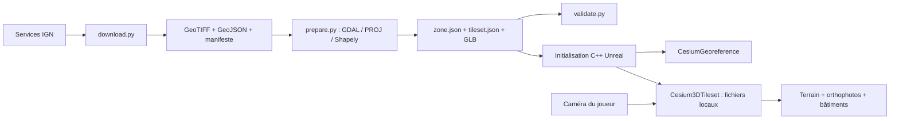

# Architecture du prototype et intégration dans un autre projet Unreal

Ce document décrit le code présent dans ce dépôt au 16 novembre 2026. Il sert
à comprendre le fonctionnement du prototype puis à en transférer les éléments
utiles dans un projet Unreal existant. Les adaptations proposées sont signalées
comme telles : elles ne constituent pas des fonctionnalités déjà implémentées.

Le [README](../README.md) contient les commandes d’installation et
d’acquisition. [VALIDATION.md](VALIDATION.md) décrit les essais effectivement
réalisés, leurs résultats et leurs limites.

## Parcours de lecture

1. [Vue d’ensemble](#1-vue-densemble)
2. [Contrats des fichiers](#2-contrats-des-fichiers)
3. [Préparation des données](#3-préparation-des-données)
4. [Coordonnées et altitudes](#4-coordonnées-et-altitudes)
5. [Exécution dans Unreal](#5-exécution-dans-unreal)
6. [Streaming et performances](#6-streaming-et-performances)
7. [Compilation et dépendances](#7-compilation-et-dépendances)
8. [Transfert dans ton projet principal](#8-transfert-dans-ton-projet-principal)
9. [Vérification après intégration](#9-vérification-après-intégration)
10. [Limites et prochaines évolutions](#10-limites-et-prochaines-évolutions)

## 1. Vue d’ensemble

Le résultat affiché est un ensemble de **maillages glTF texturés**, regroupés
en tuiles et chargés par Cesium. Le prototype ne crée pas de Landscape Unreal
et ne crée pas un Actor par bâtiment. Il ne lit pas les GeoTIFF dans le jeu.



Les trois étapes ont des responsabilités différentes :

| Étape | Où / quand | Dépendances | Réseau |
| --- | --- | --- | --- |
| Acquisition | Python, avant le jeu | `download.py`, services sources | Oui |
| Préparation et contrôle | Python, avant le jeu | NumPy, Rasterio/GDAL, PyProj/PROJ, Shapely | Aucun appel réseau |
| Affichage et navigation | C++ et Cesium dans Unreal | Plugin Cesium compilé, dossier préparé | Aucun service cartographique requis |

La première installation des outils et la compilation des dépendances peuvent
nécessiter Internet. Cela est distinct de l’exécution hors ligne du prototype.

### Carte du code

| Fichier | Responsabilité |
| --- | --- |
| [download.py](../tools/geodata/download.py) | Acquisition réelle, reprise, quota, manifeste et empreintes SHA-256 |
| [prepare.py](../tools/geodata/prepare.py) | Conversion des données acquises en tuiles GLB géoréférencées |
| [validate.py](../tools/geodata/validate.py) | Contrôle des tuiles produites sans lancer Unreal |
| [LocalTerrainGameMode.h](../Source/LiveTerrain/LocalTerrainGameMode.h) / [.cpp](../Source/LiveTerrain/LocalTerrainGameMode.cpp) | Initialisation de la zone, filtre de distance Cesium, spawn et scénario de vérification |
| [LocalTerrainEnvironment.cpp](../Source/LiveTerrain/LocalTerrainEnvironment.cpp) | Soleil, ciel, nuages, lumière ambiante, brume, exposition |
| [TerrainFlyPawn.cpp](../Source/LiveTerrain/TerrainFlyPawn.cpp) | Caméra libre avec axes de déplacement configurés |
| [TerrainHUD.cpp](../Source/LiveTerrain/TerrainHUD.cpp) | Compteur FPS et durée moyenne des images |
| [LiveTerrain.Build.cs](../Source/LiveTerrain/LiveTerrain.Build.cs) | Dépendances des modules C++ |
| [Makefile](../Makefile) / [flake.nix](../flake.nix) | Installation locale, compilation native, UBT et environnement NixOS |

## 2. Contrats des fichiers

### Entrée : le dossier d’acquisition existant

Exemple réel : `geodata-zone48_5911-2_3376-5km/`.

```text
manifest.json
relief/mnt_000000_000000.tif
orthophotos/ortho_000000_000000.tif
batiments/batiments_00000000.geojson
... autres fichiers référencés par le manifeste
```

Les noms contiennent des indices de blocs ; ils ne sont pas des coordonnées
GPS et ne doivent pas servir à déduire un géoréférencement.

| Source | Format réellement écrit | Référence spatiale | Contenu |
| --- | --- | --- | --- |
| Relief | GeoTIFF, une bande float32 | Projection locale AEQD WGS84 du manifeste, en mètres | MNT échantillonné par l’API IGN, LiDAR HD puis repli RGE ALTI ; valeur nodata `-99999` |
| Orthophotos | GeoTIFF couleur issu d’une réponse PNG WMS | EPSG:4326 avec transformation affine | Couche `ORTHOIMAGERY.ORTHOPHOTOS` ; pas demandé approximatif en mètres |
| Bâtiments | GeoJSON FeatureCollection, pages de 1 000 objets maximum | CRS84 : longitude puis latitude | Emprises Polygon/MultiPolygon et propriétés dont `hauteur` lorsqu’elle existe |
| Routes, si demandées | GeoJSON | Coordonnées géographiques | Acquises séparément ; aucune génération de routes dans le prototype |

Le MNT est un échantillonnage d’un service altimétrique, pas une collection de
nuages de points LAZ natifs. Demander des photos à 20 cm n’atteste pas une
résolution native homogène, une date de prise de vue ou une précision de 20 cm.

Le manifeste porte notamment :

- `job` : `schema`, latitude, longitude, rayon, pas MNT, pas orthophoto et options ;
- `crs_wkt` : définition complète de la projection métrique locale ;
- `bbox_crs84` : étendue géographique de l’acquisition ;
- `sources` : état de complétude et métadonnées par source ;
- `files` : chemins relatifs, tailles, empreintes SHA-256 et métadonnées de provenance.

La préparation exige le schéma 1 et les trois sources `relief`, `orthophotos`
et `batiments` à l’état `complete`. Elle vérifie les empreintes des fichiers
référencés. Un dossier simplement rempli de TIFF sans ce manifeste n’est pas
une entrée compatible avec ce pipeline.

### Sortie : le dossier livré au jeu

```text
Prepared/zone-48_5911-2_3376-5km/
    zone.json
    source-manifest.json
    tileset.json
    tile_0_0.glb
    ...
    tile_39_39.glb
```

| Fichier | Consommateur | Rôle |
| --- | --- | --- |
| `zone.json` | Initialisation C++ | Schéma, centre GPS, altitude centrale, correction verticale, paramètres et compteurs |
| `tileset.json` | Cesium | Arbre 3D Tiles 1.1, transformation géographique racine, volumes et chemins relatifs des GLB |
| `tile_*.glb` | Cesium | Géométrie, normales, UV, matériaux et PNG embarqué pour une tuile |
| `source-manifest.json` | Validation / traçabilité | Copie exacte du manifeste acquis ; conserve les références sources |

`zone.json` est écrit en dernier. Le convertisseur exige un dossier de sortie
vide et ne reprend pas une conversion partielle. Pour régénérer une zone,
utiliser un nouveau dossier de sortie ; ne pas modifier les fichiers qu’un jeu
est en train de lire. La reprise atomique du téléchargement est un mécanisme
distinct de la préparation.

Le jeu a besoin de `zone.json`, `tileset.json` et de tous les GLB référencés.
Conserver aussi `source-manifest.json` pour les contrôles et la provenance.
Ni les données brutes ni Python ne sont nécessaires sur la machine de jeu.
Ces dossiers volumineux sont ignorés par Git : prévoir leur transfert séparé.

## 3. Préparation des données

Tout ce qui suit est fait **avant le lancement d’Unreal**, dans `prepare.py`.

### Relief

Le convertisseur ouvre les MNT, vérifie leur CRS et les assemble en mémoire.
Il découpe ensuite le carré local `[-rayon, +rayon]` sur les deux axes en tuiles
de 256 m par défaut. La dernière rangée ou colonne peut être plus étroite.
Le « rayon 5 km » correspond donc ici à une emprise carrée d’environ 10 × 10 km,
et non à un découpage circulaire.

Pour chaque tuile, il crée une grille dont le pas vise celui du MNT ; les
dimensions sont ajustées pour joindre exactement ses limites. Les altitudes
sont interpolées bilinéairement aux centres des pixels du MNT. Aux seules
limites externes de couverture, l’échantillonnage est borné au raster.
Les triangles touchant une altitude nodata sont retirés, puis les sommets
inutilisés sont supprimés. Aucun relief synthétique ne remplace les trous.

Les lignes de la grille vont du nord au sud. Le sens des indices est choisi
pour orienter les faces vers le haut ; cette propriété est contrôlée par les
tests et le validateur. C’est la correction du problème initial de terrain
visible seulement par-dessous.

### Orthophotos

Chaque tuile possède une image RGB commune au terrain et aux toits. GDAL
reprojette les GeoTIFF géographiques vers une grille métrique locale, avec
rééchantillonnage bilinéaire. Le pas de texture est par défaut celui demandé
à l’acquisition, soit 0,2 m pour la zone actuelle.

Les limites de l’image sont alignées sur une grille commune de pixels,
agrandies pour inclure les toits qui débordent de la tuile et munies d’une
marge d’un pixel. Pour un point métrique local `(x, y)` :

```text
u = (x - xmin_image) / (xmax_image - xmin_image)
v = (ymax_image - y) / (ymax_image - ymin_image)
```

Le terrain et les toits utilisent cette même projection. Les parties hors
couverture acquise gardent une couleur neutre. Une dimension de texture est
limitée à 4 096 pixels ; un toit exceptionnellement étendu peut provoquer un
rééchantillonnage à cette limite, annoncé dans les logs.

Le PNG sans perte est embarqué dans le GLB. Il n’existe pas de matériau Unreal
à importer ni de service d’imagerie à configurer dans le jeu.

### Bâtiments

Chaque polygone est reprojeté en mètres puis remplacé par son **rectangle
orienté d’aire minimale**. Il s’agit bien d’une boîte simplifiée : le contour
exact d’un bâtiment concave, ses cours et ses toitures ne sont pas conservés.
Les parties d’un MultiPolygon sont traitées séparément.

Le rectangle est affecté à la tuile qui contient son centroïde. Cette règle
évite les doublons aux frontières ; un bâtiment peut déborder de sa tuile,
dont le volume englobant inclut alors cette géométrie.

La base de la boîte est à la plus basse des altitudes MNT de ses quatre coins.
Son toit est à la plus haute de ces altitudes, plus la propriété `hauteur`
si elle est positive et finie, sinon une hauteur configurable de 8 m.
Sur terrain incliné, la hauteur totale de la boîte peut ainsi dépasser la
hauteur source. Les altitudes de pied/toit éventuellement présentes dans le
GeoJSON ne sont pas exploitées par ce générateur.

Le GLB regroupe trois types de primitives : `terrain`, `building_walls`
(murs et dessous, matériau neutre) et `building_roofs` (image aérienne projetée).
Les bâtiments d’une tuile sont fusionnés dans ces primitives. Les identifiants
et propriétés individuels des objets GeoJSON ne sont pas conservés dans les
maillages : le clic sur un bâtiment n’identifie pas automatiquement sa fiche.

### Organisation 3D Tiles

Le générateur produit une racine et une liste de tuiles feuilles avec GLB,
volumes englobants et erreur géométrique nulle aux feuilles. Il n’y a qu’un
niveau de détail de contenu. La racine sans maillage a une grande erreur
géométrique pour conduire la sélection jusqu’aux feuilles.

Les données IGN ne sont donc pas chargées « directement en 3D Tiles » :
**ce convertisseur fabrique explicitement le tileset et les GLB**.

## 4. Coordonnées et altitudes

Cette chaîne est à préserver si tu transfères ou modifies le générateur :

```text
Sources géographiques / MNT en AEQD locale (m)
    → longitude, latitude WGS84 (degrés), altitude corrigée (m)
    → ECEF WGS84, EPSG:4978 (m)
    → repère ENU local autour du centre (m)
    → glTF Y-up : (Est, Haut, −Nord)
    → transformation racine du tileset vers ECEF
    → CesiumGeoreference vers le monde Unreal (cm)
```

La projection AEQD est centrée sur les coordonnées demandées. Elle fournit
les coordonnées métriques utilisées pour découper le terrain et aligner les
sources ; ce n’est pas une hypothèse de Lambert-93 imposée aux fichiers.

La conversion en ECEF est effectuée pour chaque sommet. La géométrie inclut
ainsi la courbure terrestre. Le repère ENU de sérialisation a pour origine le
centre GPS à l’altitude `height_offset`, tandis que l’origine Unreal est réglée
sur l’altitude centrale du terrain de `zone.json`. Ces deux origines peuvent
différer : la transformation racine du tileset et Cesium assurent le raccord.

Il ne faut **ni multiplier les sommets GLB par 100, ni appliquer à nouveau
leur origine GPS à l’Actor**. Les GLB sont en mètres et la conversion vers
les centimètres Unreal appartient à Cesium.

Pour placer un objet de ton jeu, réutiliser le même géoréférencement :

```cpp
// Geo est le CesiumGeoreference utilisé par le tileset.
// Ordre : LONGITUDE, LATITUDE, altitude ellipsoïdale en mètres.
const FVector PositionUE =
    Geo->TransformLongitudeLatitudeHeightPositionToUnreal(
        FVector(Longitude, Latitude, HauteurEllipsoidale));
Objet->SetActorLocation(PositionUE);
```

### Référence verticale : limite importante

Le MNT source porte des hauteurs normales IGN. Cesium attend une hauteur
ellipsoïdale WGS84. Le prototype applique seulement :

```text
h_ellipsoïdale approximée = H_IGN + HEIGHT_OFFSET
```

`HEIGHT_OFFSET=0` est un choix explicite de prototype, pas une conversion
géodésique certifiée. Relief, bâtiments et spawn partagent cette convention,
ce qui les garde cohérents entre eux. Un objet externe positionné avec une
véritable altitude ellipsoïdale peut néanmoins être décalé verticalement.

Pour une altitude absolue correcte, il faudra une correction verticale adaptée
à la zone, voire une grille de conversion. Ne pas changer seulement
`zone.json` : la correction doit aussi être appliquée aux sommets pendant
la préparation. Régénérer la zone avec le même paramètre partout.

## 5. Exécution dans Unreal

### Séquence de démarrage actuelle

La scène démarre dans `/Engine/Maps/Entry` avec `ALocalTerrainGameMode`.
Dans `StartPlay()` :

1. Les contrôles de limites du monde sont désactivés pour ce prototype.
2. Le dossier est choisi dans la configuration, puis éventuellement remplacé
   par `-GeoData=...`. Un chemin relatif est résolu depuis `FPaths::ProjectDir()`.
3. `zone.json` est lu ; le schéma, les coordonnées et l’existence du tileset
   sont vérifiés. En cas d’erreur, un log est émis et le jeu poursuit son
   initialisation sans zone géographique.
4. Le `ACesiumGeoreference` par défaut est obtenu ou créé ; son origine est
   positionnée au centre et à l’altitude de `zone.json`.
5. Un `ACesium3DTileset` est créé, associé à ce géoréférencement, configuré
   en source `FromUrl`, puis dirigé vers `file:///.../tileset.json`.
6. Un `ULocalTileRange`, composant `UCesiumTileExcluder`, est enregistré et
   activé sur le tileset pour appliquer la limite de distance.
7. L’environnement lumineux est créé, puis `Super::StartPlay()` est appelé.
8. Le Pawn du premier joueur est placé au centre GPS, 150 m au-dessus du
   terrain. Sa vitesse maximale est réglée à 150 m/s et sa vue à −15° de pitch.

L’affectation de l’URL déclenche le chargement Cesium ; `StartPlay()` n’attend
pas que toutes les tuiles soient prêtes. Le joueur peut donc apparaître avant
la géométrie. Le prototype ne propose pas encore d’écran d’attente ou de
placement d’un personnage au sol après disponibilité des collisions.

Les empreintes des données brutes sont vérifiées en préparation, pas à chaque
démarrage du jeu. Le contrôle C++ initial est volontairement plus léger que
`validate.py`.

### Configuration utile à transférer

Dans `Config/DefaultGame.ini` :

```ini
[LiveTerrain.LocalData]
Directory=Prepared/zone-48_5911-2_3376-5km
LoadDistanceMeters=10000
CacheMiB=1024
ConcurrentLoads=4
LogTileStats=true

[LiveTerrain.Environment]
SunIntensityLux=50000
SunPitch=-45
SunYaw=-30
FogDensity=0.0015
VolumetricClouds=true
```

Ces sections sont des noms lus littéralement avec `GConfig` dans `GGameIni`,
pas des classes `UDeveloperSettings`. Elles restent valides après changement
du nom du module, sauf si tu changes aussi les chaînes dans le C++.
Les valeurs de configuration utilisateur sous `Saved/Config` peuvent également
intervenir dans la configuration finale d’Unreal.

`ConcurrentLoads` est borné de 1 à 32 ; la distance de 50 à 100 000 m.
`CacheMiB` négatif est ramené à zéro. `-GeoData` remplace uniquement le dossier,
pas les autres paramètres. Le Makefile le fournit explicitement depuis `OUTPUT`.

### Éléments de démonstration remplaçables

| Élément | Fonctionnement actuel | Adaptation dans ton projet |
| --- | --- | --- |
| Caméra | `ATerrainFlyPawn`, dérivé de `ADefaultPawn`, sans bindings WASD automatiques | Garder ton Pawn/Controller et tes entrées si tu en as déjà |
| Entrées | Axes `BindAxis` configurés dans `DefaultInput.ini` : Z/S, Q/D, E/A, souris | Malgré les classes Enhanced Input configurées, aucun Input Mapping Context n’est créé ici ; intégrer à tes propres actions si nécessaire |
| Ciel | Acteurs natifs créés par `LocalTerrain::CreateEnvironment` | Ne pas recréer un soleil ou un post-process si ton niveau en possède déjà |
| FPS | `ATerrainHUD`, lissage des durées sur environ 0,5 s avec `FApp::GetDeltaTime()` | Fusionner le compteur dans ton HUD plutôt que remplacer le tien |
| Scénario automatique | `-GeoSmokeTest`, déplacement/captures puis fermeture après environ 150 s | Réserver ce mode aux vérifications ; il bloque les entrées et force le cache à zéro |

L’éclairage est un soleil fixe, pas une simulation solaire liée au GPS et à
l’heure. Le compteur FPS décrit le temps global des images, pas un profilage
séparé CPU/GPU. L’entrée `t.MaxFPS=60` du projet n’a pas imposé un plafond de
60 dans les essais : ne pas utiliser cette valeur comme garantie de cadence.

## 6. Streaming et performances

Cesium assure la sélection spatiale des tuiles, leurs lectures locales,
le décodage, la création des ressources et leur mise en cache. Le C++ du projet
ne contient pas un second chargeur asynchrone de GeoTIFF ou de maillages.
Les étapes d’intégration à Unreal et au GPU peuvent encore coûter du temps
sur les threads du moteur ; « asynchrone » ne signifie pas absence de saccades.

Le composant `ULocalTileRange` consulte la caméra du joueur d’indice 0 et
exclut une tuile si :

```text
distance(caméra, centre du volume de la tuile)
    > distance configurée + rayon de la sphère englobante
```

Ce test utilise les volumes dans le monde Unreal et des centimètres. C’est
une limite sphérique souple autour de la caméra, pas un calcul géodésique
exact sur la surface terrestre. Cesium applique aussi sa sélection liée à
la vue. Le préchargement des ancêtres et des voisins est désactivé.

**La distance de chargement n’ajoute aucune couverture aux données.** Une
distance de 10 km avec une zone acquise de rayon 5 km n’affiche pas du terrain
au-delà du carré acquis. Avec les tuiles à un seul LOD, elle peut en revanche
maintenir un grand nombre de textures détaillées nécessaires à la vue.

Le budget de 1 024 Mio est un budget de cache Cesium **souple**. Les tuiles
encore requises peuvent le dépasser, même avec un budget de zéro. Il ne borne
ni toute la RAM, ni la VRAM. Lors du test de la zone de 5 km, les données natives
suivies atteignaient environ 7,26 Go après plusieurs vues ; une sortie à 30 km
les ramenait à zéro, puis le retour rechargeait les tuiles locales.

Pour adapter le coût à une autre machine, commencer par réduire la distance,
puis comparer un dossier préparé avec `--texture-step 0.5` ou `1`. Doubler la
taille du pixel divise approximativement par quatre le nombre de pixels pour
une même surface. Augmenter `ConcurrentLoads` ne réduit pas le coût total et
peut accroître les pointes de mémoire et de création de ressources.

La préparation a ses propres coûts : mosaïque MNT en RAM, cache de 128
GeoTIFF ouverts maximum, classement préalable des bâtiments par tuile. Le
quota du téléchargeur ne couvre pas les dossiers préparés ni les caches Unreal.

### Pourquoi pas World Partition pour ces tuiles ?

Le prototype utilise uniquement le streaming Cesium pour la géographie.
Les GLB sont décrits par le tileset ; ils ne sont pas des Actors préplacés
dans des cellules World Partition. Ajouter un chargeur de cellules autour
de ces mêmes tuiles dupliquerait les décisions de visibilité et de durée de vie.

Dans un projet principal qui utilise déjà World Partition, conserver celui-ci
pour ses propres Actors de gameplay et laisser Cesium gérer ses tuiles.
Le bootstrap géographique doit rester disponible indépendamment des cellules
traversées. L’alignement des objets de gameplay avec le repère Cesium devra être
vérifié, notamment si l’origine géographique peut changer.

## 7. Compilation et dépendances

Le socle testé est Linux x86_64 / NixOS, Unreal **5.8.4**, SDK Epic
v26 / Clang 20.1.8, Cesium for Unreal **2.31.0** et cesium-native **0.66.0**.
Le commit du plugin est fixé dans le Makefile. Le contrôle moteur et le script
de configuration refusent les versions Unreal autres que 5.8 : une migration
de version exige une vérification de compatibilité et des API, pas seulement
un changement de numéro dans le `.uproject`.

La chaîne de compilation est :

```text
make setup
    → clone récursif du plugin dans Plugins/CesiumForUnreal
    → contrôle du commit et initialisation des sous-modules
    → adaptation locale du descripteur Cesium à UE 5.8
make native
    → CMake sur extern/ avec unreal-linux-toolchain.cmake
    → Ninja, compilation et installation des dépendances dans le plugin
make cesium / make build
    → UBT : modules Cesium et module LiveTerrain, cible LiveTerrainEditor
make run
    → même build incrémental, puis UnrealEditor avec -game
```

`tools/configure_cesium.py` adapte uniquement `EngineVersion` du descripteur
officiel 2.31.0, encore à 5.6.0 dans ces sources, vers 5.8.0. Aucun code C++
du plugin ni fichier de l’installation globale du moteur n’est modifié.
La configuration native garde `CESIUM_TESTS_ENABLED=ON` parce que le CMake
externe de cette version référence la cible de tests ; cela ne lance pas
automatiquement ces tests avec le build `install`.

CMake/Ninja et UBT conservent leurs dépendances incrémentales. La signature
native enregistre le moteur, le SDK, la configuration et le commit Cesium.
`make clean` nettoie les sorties Unreal de l’application ; `clean-native`
supprime aussi les sorties natives/plugin. Les acquisitions et préparations
ne sont pas effacées par ces cibles.

Sur NixOS, `nix develop` fournit les bibliothèques Python et outils de
préparation. `nix run .#ue-shell -- ...` fournit le FHS nécessaire aux binaires
Epic, aux bibliothèques graphiques et aux outils natifs ; la toolchain C++
reste celle d’Unreal. Conserver `flake.lock` pour reproduire cet environnement.

Le graphe `-DDC=Offline` configure le cache de données dérivées sur disque,
sans Zen. Il concerne les données dérivées/shaders du moteur, pas le streaming
géographique, qui utilise séparément les URL `file://`.

## 8. Transfert dans ton projet principal

### Option A : reproduire d’abord le prototype dans une carte de test

C’est la façon de vérifier le transfert avec le moins de changements à la fois.

1. Utiliser initialement la même version d’Unreal et la même révision Cesium.
   Installer le plugin dans le `Plugins/` de ton projet et y compiler ses
   dépendances natives avec la toolchain de ce moteur. Ne pas transférer les
   binaires du plugin comme solution portable entre versions ou plateformes.
2. Copier les huit fichiers `.h/.cpp` de `LocalTerrainGameMode`,
   `LocalTerrainEnvironment`, `TerrainFlyPawn` et `TerrainHUD` dans ton module
   C++ Runtime. Remplacer `LIVETERRAIN_API` par la macro d’export de ce module,
   par exemple `MONPROJET_API`. Les noms des classes peuvent rester identiques
   s’il n’existe pas de conflit ; conserver les inclusions `.generated.h`.
3. Dans ton `Build.cs`, ajouter `CesiumRuntime` et `Json` aux dépendances.
   Conserver les dépendances Unreal habituelles `Core`, `CoreUObject`, `Engine`
   et `InputCore`. Le prototype déclare aussi `EnhancedInput` ; son Pawn
   emploie toutefois les axes classiques et ne définit pas d’actions Enhanced Input.
4. Activer le plugin `CesiumForUnreal` dans ton `.uproject`. Les plugins MCP,
   les toolsets expérimentaux et Modeling Tools présents dans ce dépôt ne
   sont pas requis pour afficher la géographie. Ne pas recopier tout le
   `.uproject`, ni remplacer le module de ton projet par `LiveTerrain`.
5. Copier le dossier préparé complet dans `Prepared/` à la racine du projet,
   ou fournir son chemin absolu par `-GeoData`. Pour le seul affichage, aucune
   nouvelle acquisition ni conversion n’est nécessaire.
6. Ajouter les sections `LiveTerrain.LocalData` et `LiveTerrain.Environment`
   de ce guide à ton `DefaultGame.ini`. Ajouter uniquement les mappings
   `Terrain...` nécessaires de `DefaultInput.ini` si tu utilises le Pawn fourni.
7. Dans une carte de test, choisir `LocalTerrainGameMode` comme GameMode
   Override. Pour un réglage global équivalent, le chemin de classe devient
   `/Script/MonProjet.LocalTerrainGameMode`, où `MonProjet` est le nom réel du
   module, pas le nom du dossier de données. Une surcharge dans la carte peut
   prendre le dessus sur le GameMode global.
8. Vérifier les réglages de rendu : l’environnement suppose notamment la
   plage étendue d’exposition EV100. Ne pas recopier aveuglément toutes les
   options graphiques du prototype, ses redirections ou ses paramètres de plateforme.
9. Adapter l’automatisation de build : le Makefile fixe `LiveTerrain.uproject`
   et la cible `LiveTerrainEditor`. Changer ces deux références pour ton projet,
   ainsi que les chemins moteur/SDK. `DATA`, `OUTPUT`, `UE_ROOT` et `SDK` sont
   paramétrables ; le nom de cible Unreal n’est pas encore une variable dédiée.
10. Compiler et lancer la carte de test, puis suivre les contrôles de la
    section suivante avant de fusionner avec ton gameplay.

Les assets `Content/Untitled*` et les Actors externes présents dans ce dépôt
ne sont pas la source de la scène géographique utilisée par `make run`.
La reproduction avec `/Engine/Maps/Entry` est initialisée par le C++, sans
dépendance à cette carte utilisateur.

### Option B : intégrer la géographie à ton architecture de jeu

Après le test ci-dessus, conserver ton GameMode, ton joueur, ton HUD et ton
éclairage. Le point d’entrée actuel regroupe plusieurs responsabilités pour
rester court ; il n’impose pas de remplacer tout ton gameplay.

**Refactorisation proposée, non encore réalisée dans ce dépôt :** déplacer
la lecture de zone et la création du géoréférencement/tileset/filtre dans un
Actor de bootstrap persistant, ou un sous-système de monde adapté à ton projet.
L’initialiser une seule fois quand le monde et la caméra sont disponibles.
Garder les références Unreal nécessaires dans des propriétés suivies par le
GC et prévoir le nettoyage si la zone est remplacée.

| Partie de `StartPlay()` | À conserver / adapter |
| --- | --- |
| Lecture et validation de `zone.json` | Conserver le contrat ou versionner explicitement son évolution |
| Origine Cesium | Réutiliser une référence clairement choisie pour toutes les couches |
| Création du tileset, `FromUrl`, paramètres et filtre | Cœur du chargement local à transférer |
| `CreateEnvironment` | Omettre si ton niveau a déjà son environnement |
| `Super::StartPlay()` | Reste dans ton propre GameMode ; ne pas le transposer dans un Actor |
| Placement du Pawn et vitesse | Remplacer par ton système de spawn et de navigation |
| `DefaultPawnClass`, `HUDClass` | Garder les classes de ton projet |
| `-GeoSmokeTest` | Conserver uniquement comme outil de validation si utile |

Points à traiter lors de cette adaptation :

- **Multijoueur :** le GameMode n’existe pas sur les clients distants. Le
  démarrage actuel est prévu pour une exploration locale ; il n’installe pas
  automatiquement une scène géographique sur chaque client. Initialiser le
  rendu local dans un objet présent côté client et choisir une autorité claire
  pour les coordonnées partagées. Le filtre ne regarde que la caméra du joueur 0.
- **Origine existante :** le code actuel modifie le géoréférencement par défaut.
  Si ton monde en utilise déjà un, décider qui en possède l’origine. Ne pas
  déplacer cette origine sans gérer aussi les objets de gameplay concernés.
  Le prototype ne met pas en place une politique de recentrage pendant le vol.
- **Objets persistants :** conserver leurs coordonnées géographiques et
  recalculer leur position si l’origine change, ou étudier les composants
  d’ancrage Cesium du plugin. Un simple `SetActorLocation` ne crée pas d’ancrage.
- **Changement de zone :** aucun `LoadZone()` à chaud n’est fourni. Prévoir
  l’arrêt des timers de vérification, le retrait du tileset/filtre précédents,
  la gestion des références et du joueur avant d’initialiser la suivante.
  Ne pas rappeler tout `StartPlay()` pour charger une autre zone.
- **Personnage au sol :** les essais portent sur une caméra volante. Vérifier
  les collisions, la disponibilité du terrain et le comportement du mouvement
  avant d’y faire marcher ou rouler un joueur ; aucune navigation IA n’est générée.

### Distribution des données et exécutable final

La compilation et les essais actuels portent sur une cible **Editor Development
lancée avec `-game`**. Ils ne démontrent pas encore un package autonome Shipping.
Le Makefile ne possède pas de cible cook/stage/package.

Pour ton exécutable final, il reste à :

1. Construire et tester ta cible de jeu avec le plugin pour la plateforme visée.
2. Distribuer les données préparées comme de vrais fichiers accessibles au
   lecteur `file://`. Un fichier uniquement enfermé dans un conteneur Unreal
   Pak/IoStore n’est pas automatiquement lisible par ce chemin Cesium.
   Une solution est un dossier externe livré à côté du jeu avec chemin
   absolu via `-GeoData` ; une autre est un staging NonUFS explicitement vérifié.
3. Adapter le chemin par défaut à l’arborescence du build distribué. Ne pas
   supposer que `FPaths::ProjectDir()` est le répertoire de l’exécutable.
4. Faire inclure au cook les assets nécessaires, en particulier le matériau
   de nuages chargé par nom dans `CreateEnvironment`. Son chemin est
   `/Engine/EngineSky/VolumetricClouds/m_SimpleVolumetricCloud_Inst.m_SimpleVolumetricCloud_Inst`.
   La disponibilité de cet asset dans l’éditeur ne prouve pas sa présence dans
   le package ; prévoir une référence ou une règle de cook adaptée.
5. Vérifier un lancement sur une machine propre, sans données brutes, sans
   Python et sans connexion réseau. Garder les attributions IGN avec les données.

## 9. Vérification après intégration

### Contrôle hors moteur

Depuis le dépôt du prototype, dans `nix develop` :

```bash
make test
make validate OUTPUT=Prepared/zone-48_5911-2_3376-5km
```

Pour produire une autre variante, utiliser un dossier neuf :

```bash
make prepare DATA=geodata-zone48_5911-2_3376-5km \
  OUTPUT=Prepared/zone-5km-50cm HEIGHT_OFFSET=0 \
  PREPARE_ARGS='--texture-step 0.5'
make validate OUTPUT=Prepared/zone-5km-50cm
```

Le validateur contrôle les buffers GLB, indices, limites, images non uniformes,
normales et faces vers le haut, sommets partagés, positions ECEF, UV et comptes
de bâtiments/toits. La comparaison image/géométrie tolère 2 mm pour tenir compte
des arrondis float32. L’écart mesuré de 0,252 mm sur la zone actuelle est une
cohérence interne de conversion, **pas une précision topographique réelle**.

### Contrôle dans le jeu

Dans le prototype :

```bash
make run OUTPUT=Prepared/zone-48_5911-2_3376-5km \
  RUN_ARGS='-windowed -ResX=1280 -ResY=720'

# Scénario automatique, qui ferme le jeu à la fin :
make run OUTPUT=Prepared/zone-48_5911-2_3376-5km \
  RUN_ARGS='-GeoSmokeTest -windowed -ResX=1280 -ResY=720'
```

Dans ton projet, reprendre les arguments de données avec ta carte de test et
ta cible. Le scénario automatique suppose encore le spawn et le repère du
prototype ; il faudra l’adapter si tu changes ces conventions.

Vérifier successivement :

1. Le log `LogLocalTerrain: Offline zone` annonce le bon dossier, les
   coordonnées du centre et les paramètres attendus.
2. Le terrain est visible du dessus ; routes, champs et toits s’alignent sur
   les images. La zone actuelle doit montrer l’aérodrome visible sur la capture
   [zone-5km-fps.png](zone-5km-fps.png).
3. Le joueur apparaît au centre, à environ 150 m au-dessus du MNT, avec les
   entrées de navigation prévues.
4. Un déplacement provoque des lectures locales sans téléchargement de données.
   Le scénario sort à 30 km, constate la libération, puis revient au centre.
   Les compteurs `Smoke cache` ne sont pas des mesures complètes RAM/VRAM.
5. Un essai réseau réellement désactivé restitue le même terrain. Le simple
   argument `-DDC=Offline` ne prouve pas à lui seul l’absence de réseau.
6. Les shaders et assets fonctionnent aussi dans le mode de distribution visé.

### Diagnostic rapide

| Symptôme | Premier point à examiner |
| --- | --- |
| Jeu vide, erreur de zone | Chemin `-GeoData`, schéma de `zone.json`, existence de `tileset.json` |
| Ton ancien gameplay apparaît | GameMode Override de la carte et chemin `/Script/NomModule.Classe` |
| Relief visible par-dessous seulement | Sens des indices/normales dans une version modifiée du générateur |
| Décalage horizontal des images/toits | CRS réels, ordre longitude/latitude, limites de l’image et UV partagés |
| Décalage vertical avec tes objets | Altitudes normales contre ellipsoïdales, correction appliquée une ou deux fois |
| Lumière surexposée ou double ciel | Deux environnements créés, réglages EV100 différents, post-process existant |
| Terrain absent aux lointains | Limite d’acquisition, filtre de distance, sélection Cesium ; aucun LOD distant généré |
| Mémoire supérieure au cache configuré | Tuiles encore requises, textures détaillées, budget Cesium souple |
| Aucun terrain sur un client réseau | Bootstrap uniquement dans le GameMode serveur |
| Fonctionne dans l’éditeur mais pas en package | Plugin compilé pour le jeu, staging des fichiers locaux, chemin résolu, cook du matériau de nuages |

## 10. Limites et prochaines évolutions

La zone actuelle couvre un carré d’environ 10 × 10 km autour de
48.59110362034471 N, 2.337593065968919 E, avec MNT à 10 m, textures préparées
à 20 cm, 1 600 tuiles et 36 697 boîtes de bâtiments. Elle occupe environ
3,1 Gio préparés, en plus des 5,19 Go de fichiers acquis. Le centre à MNT
5 m de l’ancienne acquisition est conservé séparément ; il n’est pas fusionné
dans la zone de 5 km.

Pour faire évoluer le prototype, les points d’extension sont identifiables :

| Besoin | Partie à faire évoluer |
| --- | --- |
| Lointains moins coûteux | `prepare.py` : hiérarchie de tuiles, maillages/images simplifiés et erreurs géométriques cohérentes ; le LOD supplémentaire n’existe pas encore |
| Emprises exactes et formes concaves | Générateur de bâtiments : triangulation des polygones et prise en compte des trous |
| Identification des bâtiments | Conserver les IDs/propriétés et une correspondance avec la géométrie ou des métadonnées 3D Tiles |
| Altitudes absolues fiables | Préparation : correction verticale appropriée aux données et à la zone |
| Plusieurs zones à chaud | Cycle de vie du bootstrap C++, configuration et gestion des références |
| Gameplay au sol | Chargement initial, collisions, spawn sécurisé et navigation à vérifier / implémenter |
| Application distribuable | Cible de jeu, cook/stage/package, données locales et vérification sur machine propre |

Le cœur réutilisable est le contrat des dossiers préparés, la chaîne de
coordonnées et le chargement `Cesium3DTileset` local. Caméra, HUD, ciel et
GameMode constituent le cadre de démonstration et peuvent être remplacés
par ceux de ton projet tout en conservant ce cœur.
