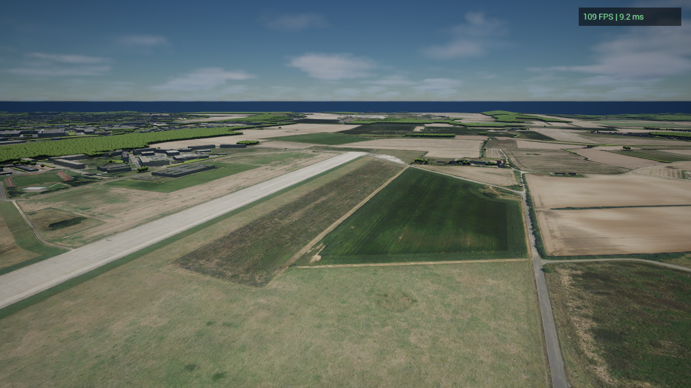

# Static geographic scene features

The current default renders trees using [native textured meshes](TREE_MESHES.md).
This page describes the geographic sources and the original baked layer used
as input to that conversion.

Trees, hedges, and parked passenger cars are baked into local GLBs and streamed
by Cesium with the terrain. No traffic simulation or network access is needed
in Unreal. Source positions are WGS84; preparation transforms them into the
same geographic frame and vertical reference as the terrain. Bounds include
crowns and vehicles so streaming does not clip them.

## Current fidelity

This is a **prototype scene layer**, not a photoreal reconstruction. Tree crowns,
trunks, hedges, and cars use simple procedural geometry and solid materials.
Existing terrain imagery and roofs retain their original resolution.

IGN BD TOPO vegetation polygons constrain woodland and hedge coverage. Tree
centres inside woodland are deterministic estimates at 8 m spacing; they are
not individual trees measured by LiDAR. Default woodland height is 12 m;
hedgerows use 2.5 m. Polygon holes are respected. Vines and non-woody land cover
are excluded. IGN boundaries and imagery may have different acquisition dates.

The reviewed car file contains **13 examples**, identified in parking bays in
`orthophotos/ortho_024576_010240.tif` of the current acquisition. Coordinates and
headings are approximate manual image interpretations, with a source SHA-256
and source pixel for review. Dimensions are generic passenger-car dimensions.
This is not an inventory of every parked vehicle. Vehicles on traffic lanes
were excluded. No model detects cars automatically.

Mapped individual OSM trees and hedge lines can also be fetched. Coverage
varies; default dimensions are used where numeric dimensions are unavailable.
Point features can be supplied from reviewed imagery or a LiDAR detection
pipeline later without changing the runtime.

## Prepare the current zone

Run in `nix develop` with the existing Python dependencies. Keep feature files
outside acquisition directories, whose manifests are immutable.

```bash
python tools/geodata/fetch_vegetation.py \
  --input geodata-zone48_5911-2_3376-5km \
  --placements geodata-features/zone-48_5911-2_3376-parked-cars.geojson \
  --output Prepared/scene-features-48_5911-2_3376.geojson

python tools/geodata/add_scene_features.py \
  --base Prepared/zone-48_5911-2_3376-5km \
  --features Prepared/scene-features-48_5911-2_3376.geojson \
  --output Prepared/zone-48_5911-2_3376-features

python tools/geodata/validate.py Prepared/zone-48_5911-2_3376-features
make run OUTPUT=Prepared/zone-48_5911-2_3376-features
```

The enrichment tool writes a **new directory**, rebuilding only tiles with
features. Other GLBs are hard-linked where possible, copied otherwise. It
preserves the original zone, refuses a nonempty output, and rejects enriching
an already enriched base to prevent duplicate objects. Terrain triangles supply
barycentric ground heights; features over missing terrain are omitted.

To prepare from acquisitions in one pass, pass `--features FILE.geojson` to
`tools/geodata/prepare.py`, or set `PREPARE_ARGS='--features FILE.geojson'` for
`make prepare`. To fetch mapped individual vegetation instead of estimated
woodland trees:

```bash
python tools/geodata/fetch_scene_features.py \
  --input geodata-zone48_5911-2_3376-5km \
  --output Prepared/osm-scene-features.geojson
```

The OSM endpoint can be changed using `--overpass URL`. Downloaders reject
incomplete responses; a server failure must not silently become empty coverage.

## Feature format

Use an RFC 7946 WGS84 GeoJSON FeatureCollection without a `crs` member. Every
feature needs a `source` attribution. Accepted properties and geometries:

| kind | geometry | dimensions in metres |
| --- | --- | --- |
| `tree` | Point | `height`, `crown_diameter` |
| `hedge` | LineString | `height`, `width` |
| `parked_car` | Point | `length`, `width`, `height`; required `heading` |
| `woodland` | Polygon or MultiPolygon | `height`, `crown_diameter`, `spacing` |
| `hedgerow` | Polygon or MultiPolygon | `height`, `crown_diameter`, `spacing` |

`heading` is degrees clockwise from geographic north; zero aligns the car
length north/south. Cars are static. `color: "red"` selects red paint;
otherwise neutral grey is used. Dimensions must be positive and finite.
Hedges are segmented for streaming. Duplicate anchors of the same kind within
1 mm are suppressed; features outside the acquisition square are ignored.

The current local zone contains 238,291 estimated trees, 451,726 hedge geometry
segments, and 13 reviewed parked cars. The hedge count measures geometry
segments, not distinct mapped hedgerows. `make run` and the editor now select
the native tree-mesh zone by default. `make prepare` includes `FEATURES` when that
file exists; set `FEATURES` explicitly to use another source.

Feature provenance, input hash, generated counts, and fidelity notes are stored
in `zone.json`, and the source GeoJSON is copied alongside the tileset.
Attributions also appear in GLBs and the tileset.

## Validation

`make test` covers source filtering, invalid inputs, deterministic woodland
coverage and holes, terrain anchoring, car orientation, duplicate suppression,
original-zone preservation, and an end-to-end preparation/enrichment/validation
fixture. The validator checks feature normals, indices, and expanded bounds,
alongside existing terrain, building, imagery, and shared-edge checks.

Local validation on 2026-11-16: 20 automated tests passed; all 1,600 enriched
tiles and 36,697 textured roofs passed validation (98,196,260 triangles).
Maximum imagery registration error was 0.000252 m. The existing Unreal
offscreen smoke run reached 100% loading at the origin and displaced views,
unloaded geometry outside the zone, and reloaded it on return. The preview
shows one captured frame at 109 FPS; this is not a general performance guarantee.


