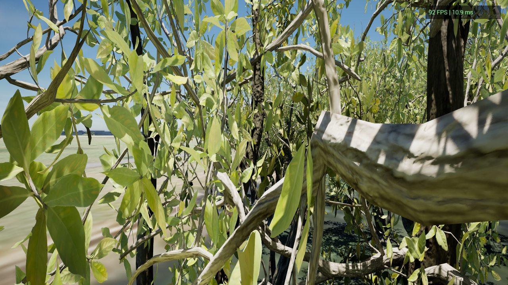
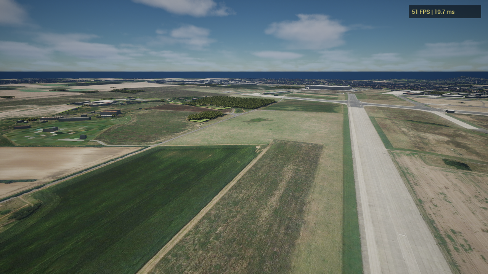

# Native textured tree meshes

The default zone is `Prepared/zone-48_5911-2_3376-tree-meshes`. Its 238,291 tree
anchors now use an actual textured mesh, replacing the previous ellipsoid crowns
and box trunks. Hedges and parked cars retain their existing geometry.

The model is [Island Tree 02](https://polyhaven.com/a/island_tree_02), by Rico
Cilliers and Rob Tuytel, provided under [CC0](https://polyhaven.com/license).
**Powered by Poly Haven.** Source attribution is retained in
`Content/Vegetation/IslandTree02/`. It is an illustrative coastal tree asset,
not an identification of the species growing at each geographic location.
Woodland-derived positions and dimensions remain estimates.

The asset includes bark, branch and leaf textures at 2K, roughness and normal
maps, a separate opacity mask, and two-sided foliage shading. The imported mesh
has 1,072,213 source triangles and uses Nanite with area preservation. Leaf UVs
are rebuilt from the source glTF: the direct FBX import did not map the leaf
atlas correctly. The OBJ conversion also bakes branch texture transforms and
converts metres/Y-up to Unreal centimetres/Z-up.

## Use

After this C++ change, **restart the editor** before using Play. Alternatively,
`make run` launches a fresh game process with the updated module. The currently
running editor is left open to preserve any unsaved work.

`[LiveTerrain.Trees]` in `Config/DefaultGame.ini` selects the mesh and the 3,000 m
instance cull distance. Changing the mesh path reuses the existing placements.
The renderer adjusts width and height to the prepared dimensions, aligns the
mesh base to the terrain, and varies yaw without moving the anchors. One shared
mesh and a hierarchical instanced component avoid duplicating the detailed mesh
for every tree. Collision and navigation generation are disabled for the flyover.
Instances remain resident; Unreal culls their rendering by distance and cluster.
The terrain, hedges, roofs and cars continue streaming through Cesium.

To convert another existing baked feature zone:

```bash
python tools/geodata/native_trees.py \
  --base Prepared/zone-48_5911-2_3376-features \
  --output Prepared/my-tree-mesh-zone
python tools/geodata/validate.py Prepared/my-tree-mesh-zone
make run OUTPUT=Prepared/my-tree-mesh-zone
```

`make trees FEATURE_BASE=... OUTPUT=...` performs this conversion too. Outputs
must be new/empty. Existing geographic positions are extracted from the baked
trunks, transformed to ECEF, and stored with their dimensions in `trees.bin`.
The tool removes the old tree primitives and retains the original imagery,
hedges and parked cars. It never modifies the base zone.

`make prepare HEIGHT_OFFSET=...` now prepares an intermediate `$(OUTPUT)-baked`
zone, then converts it to the final native-tree zone. It includes `FEATURES`
when that file exists. See [geographic feature acquisition](STATIC_SCENE_FEATURES.md)
for fetching the vegetation boundaries and reviewed vehicle placements first.

To retrieve the source for reimport, run in the geodata development environment:

```bash
python tools/assets/fetch_tree.py
```

It verifies source download sizes/checksums and writes the corrected OBJ and MTL
to `.build/tree-assets/island_tree_02/`. The finished Unreal assets are already
included in `Content/Vegetation/IslandTree02/`, so no runtime download is needed.
The imported slots are `island_tree_02`, `island_tree_02_leaves`, and
`island_tree_02_branches`. Their saved material graphs use the matching textures;
normal maps flip the green channel for Unreal. Nanite and instanced-static-mesh
material usage flags are enabled. The leaf material uses UV channel zero and a
masked, two-sided foliage shader.

## Binary placements and verification

`trees.bin` has a 12-byte little-endian header: `LTRE`, uint32 version 1,
uint32 count. Each 32-byte record contains three float64 ECEF coordinates in
metres, a float32 height, and a float32 crown diameter. `zone.json` records its
count, SHA-256, source model and placement limitations. Both preparation and
runtime reject malformed data. The validator checks the source checksum,
geographic range, dimensions, and absence of leftover tree placeholders.

Validation on 2026-11-16: C++ build succeeded; 21 automated tests passed,
including UV/orientation conversion and geographic anchor preservation. All
1,600 converted tiles and all 238,291 native placements passed validation;
maximum imagery registration error remained 0.000252 m. The close-up below is
an actual offscreen Unreal capture with leaves and bark visible (92 FPS in
that captured frame, not a performance guarantee).




